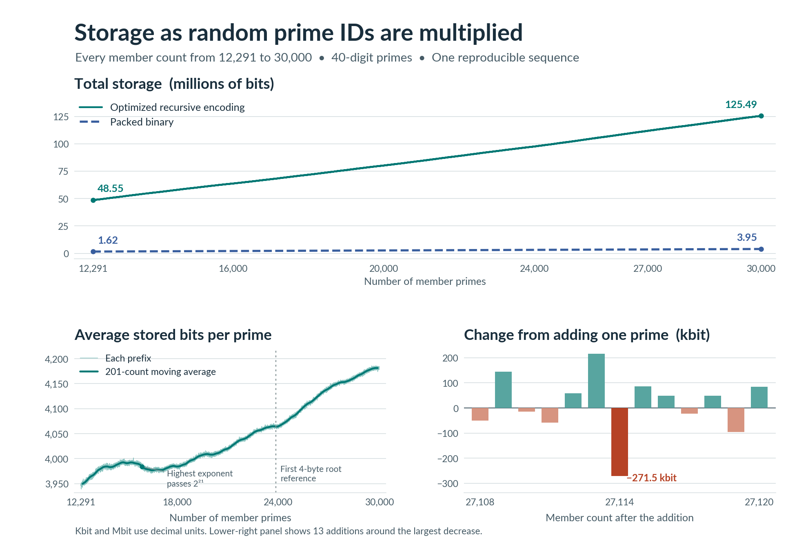

# Does multiplying by another prime make the stored number smaller?

**Yes, on 8,289 additions.** I measured the optimized recursive signed-power representation at every prime count from **12,291 to 30,000**, extending the first random 40-digit trial. Inside that interval **46.8% of individual additions shrank the file**. Across the full interval, total storage rose from **48.55 to 125.49 million bits**, and average storage rose from **3,950 to 4,183 bits per member**.



The top panel compares the bytes the H2N1 encoder needs with the bytes needed to pack the integer in ordinary binary. The lower-left panel divides the H2N1 bit count by the number of primes. The light trace includes all 17,710 products and the dark line is a centered 201-count moving average. The lower-right panel shows 13 individual additions around the largest decrease. Kbit and Mbit use decimal units. [Download the measurements for every count](../benchmarks/results/prime-access-storage-growth.csv)

## What happened as the exponents grew

| Member primes | Optimized bytes | Packed bytes | Optimized bits per prime | Optimized / packed |
| ---: | ---: | ---: | ---: | ---: |
| 12,291 | 6,069,201 | 202,484 | 3,950.3 | 29.97× |
| 15,000 | 7,484,573 | 247,111 | 3,991.8 | 30.29× |
| 16,500 | 8,199,492 | 271,825 | 3,975.5 | 30.16× |
| 20,000 | 10,005,561 | 329,483 | 4,002.2 | 30.37× |
| 24,000 | 12,192,278 | 395,371 | 4,064.1 | 30.84× |
| 30,000 | 15,686,193 | 494,227 | 4,183.0 | 31.74× |

**A drop at an exponent boundary.** At 15,913 primes, the highest canonical root exponent first passed 2²¹. That multiplication grew the integer and shrank its encoded file by **1,584 bytes**. The average also fell across a wider interval, from 3,991.8 bits per prime at 15,000 to 3,975.5 at 16,500. Crossing this boundary coincided with a saving on this sequence. The later counts show it was temporary.

**The largest single saving.** Adding prime number **27,114** grew the integer by 132 bits. Its new representation needed **2,563 fewer signed terms in the root**, and the file fell from 14,067,129 to 14,033,190 bytes. That saves **33,939 bytes** in one multiplication. This is how a larger number can need fewer stored symbols.

**A cost of going deeper and wider.** Each term has to name an exponent. At 23,854 primes the root first needed a four-byte exponent reference. The count briefly moved back and forth across that boundary. Every label from 23,881 onward required four-byte references. At 30,000, the root contained 1,318,357 signed terms. Sharing exponent definitions saved space, while the sheer number of references kept the label much larger than packed binary.

Of the **17,709 adjacent comparisons** entirely within the requested interval, 8,289 decreased and 9,420 increased. The CSV also includes the 12,290-prime baseline from trial A so the first requested addition can be inspected. That extra addition increased the file by 2,136 bytes.

## Could a better optimizer reverse the result?

For every count, the CSV includes both the actual H2N1 byte count and a lower bound on the smallest legal encoding of that integer. Their largest separation was **141 bytes**. At 30,000 primes the interval was **15,686,102 to 15,686,193 bytes**. More search could save at most 91 bytes at the endpoint. Even the lower bound exceeded packed binary by **more than 29.88× at every measured count**.

The bounds also distinguish real decreases from search variability. For **8,206** of the 8,289 downward steps, the new file was smaller than the *lower bound* for the preceding integer. Thus even the true minimum file size decreased on those steps. These results concern one reproducible sequence of random 40-digit primes in H2N1. The experiment covers counts through 30,000.

## Measurement and verification

- **Inputs.** I continued seed 20261128 from the earlier random-prime trial. The first 12,290 members match trial A exactly. Alice, the original outsider, and the 32 earlier negative controls stayed outside the set. The next 17,710 distinct accepted 40-digit primes were appended in draw order. FLINT's proven primality test was used for acceptance. [Original sampler and trial A](random-40-digit-prime-access.md)
- **Size at every count.** Each new ID was multiplied into the preceding value using bounded signed blocks. A native version of the same two-state carry dynamic program, with the same tie rule and low-exponent rewrite, counted the exact bytes the encoder would emit. It charged the actual reference widths, including the fourth byte when the root crossed 1,048,576 distinct references. Three checkpoint files were physically serialized with the original encoder. The sweep gives file sizes rather than a benchmark of disk-write latency.
- **Bounds.** The earlier certificate charges each selected exponent for its own definition and a root reference. Here it also charges the unavoidable fourth byte for at least `max(0, minimum_root_terms − 1,048,576)` references. The known minimum root term count is the weight of the canonical nonadjacent signed expansion. This adjustment keeps the certificate tight above the reference-width boundary. [Original certificate](prime-product-reachability-demo.md#why-the-size-certificate-covers-all-exponent-depths)
- **Independent checks.** Outward-rounded product bounds confirmed the exact magnitude bit length at every prefix. At 12,291, 24,000 and 30,000, the original multiplication kernel reproduced every canonical signed position, and the original encoder/decoder verified the recorded byte counts. At 30,000, every intended prime divided the decoded file. Its positive value had the independently verified 3,953,815-bit width of their product, which proves it represented exactly that product. The outsider returned a nonzero remainder. Removing the final member and multiplying it back restored the complete canonical row.

The 30,000-member input stream has SHA-256 `39c157d6c06b8794421b7ca1bf884d2faebc909de1d23637f968918aba82e9f5` when each prime is stored in 17 big-endian bytes. The 30,000-prime H2N1 file has SHA-256 `cc05f36b450af135f7ad7e4b82722d5bff560d52a69ac3a197d6860a4a679b65`.

<details>
<summary>Reproduce a checkpoint from the original arithmetic code</summary>

From the repository root, use Python 3.11+, python-flint 0.8.0 and a C++17 compiler. This example reconstructs the final file from the seed. The individual prime IDs, small exponents and modular coefficients fit in bounded integers throughout. The full product is carried in signed coordinates.

```python
from hashlib import sha256
from pathlib import Path
from random import Random
import re
import subprocess
import sys
from tempfile import TemporaryDirectory
from flint import fmpz

repo = Path.cwd()
source = (repo / 'docs/prime-product-reachability-demo.md').read_text()
rng = Random(20261128)
seen, members = set(), []
sieve = (3, 5, 7, 11, 13, 17, 19, 23, 29, 31, 37, 41, 43, 47)
while len(members) < 30000:
    p = rng.randrange(10**39 + 1, 10**40, 2)
    if p in seen or any(p % d == 0 for d in sieve) or not fmpz(p).is_prime():
        continue
    index = len(seen)
    seen.add(p)
    if index not in (0, 3) and not 12292 <= index < 12324:
        members.append(p)

digest = sha256(b''.join(p.to_bytes(17, 'big') for p in members)).hexdigest()
assert digest == '39c157d6c06b8794421b7ca1bf884d2faebc909de1d23637f968918aba82e9f5'
with TemporaryDirectory() as tmp:
    work = Path(tmp)
    marker = chr(96) * 3
    for lang, name in [('python', 'access.py'), ('cpp', 'merge.cpp')]:
        block, = re.findall('^' + marker + lang + r'\n(.*?)^' + marker + '$', source, re.M | re.S)
        (work / name).write_text(block)
    subprocess.run(['c++', '-O3', '-std=c++17', str(work/'merge.cpp'), '-o', str(work/'merge')], check=True)
    sys.path[:0] = [str(work), str(repo/'src')]
    import access
    circuit = access.Circuit()
    row = access.merge([access.input_row(circuit, p) for p in members])
    wire, original_bound = access.optimize(row)
    minimum_terms = len(row) - row.count(b'0')
    lower_bound = original_bound + max(0, minimum_terms - 1048576)
    assert (len(wire), lower_bound) == (15686193, 15686102)
    assert sha256(wire).hexdigest() == 'cc05f36b450af135f7ad7e4b82722d5bff560d52a69ac3a197d6860a4a679b65'
```

</details>
